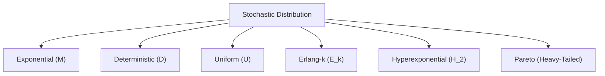

# Queueing System Simulator

[](https://www.python.org/)
[](https://riverbankcomputing.com/software/pyqt/)
[](https://matplotlib.org/)
[]()

An interactive **Discrete-Event Simulation (DES)** and pedagogical queueing theory workstation designed for Master's degree courses in **Network Design**, **Teletraffic Engineering**, and **Computer Systems Performance Modeling**.

The platform combines an event-driven stochastic simulation engine, a real-time 2D animated vector canvas, live birth-death Markov chain visualization, dynamic Matplotlib analytics, and an integrated **16-pages educational theory library** with Computer Modern $\mathrm{\LaTeX}$ formulas.

---

## Table of Contents

1. [Key Features](#key-features)
2. [Theoretical Foundation & Course Nomenclature](#theoretical-foundation--course-nomenclature)
3. [Supported Stochastic Distributions](#supported-stochastic-distributions)
4. [Queueing Models & Kendall Notation](#queueing-models--kendall-notation)
5. [Architecture & Project Structure](#architecture--project-structure)
6. [Installation & Requirements](#installation--requirements)
7. [Usage Guide](#usage-guide)
   - [Interactive GUI Mode](#interactive-gui-mode)
   - [Headless CLI Batch Mode](#headless-cli-batch-mode)
8. [GUI Interface Walkthrough](#gui-interface-walkthrough)
   - [Live Simulation & Vector Canvas](#live-simulation--vector-canvas)
   - [Markov Chain Transition Diagram](#markov-chain-transition-diagram)
   - [Analytics & Histograms](#analytics--histograms)
   - [Theoretical Validation & Little's Law](#theoretical-validation--littles-law)
   - [Embedded $\mathrm{\LaTeX}$ Theory Textbook](#embedded-mathrmlatex-theory-textbook)
   - [Smart Context-Sensitive Optical Zoom](#smart-context-sensitive-optical-zoom)
9. [CLI Command-Line Reference](#cli-command-line-reference)
10. [Verification & Little's Law Convergence](#verification--littles-law-convergence)

---

## Key Features

- **Event-Driven Simulation Engine (`core.engine.QueueSimEngine`)**:
  - Implements a precise calendar queue utilizing a min-heap priority queue (`heapq`) with zero-polling discrete-event transitions (`arrival`, `departure`).
  - Supports single-class FIFO queues and multi-class non-preemptive priority queueing ($P_0$ High, $P_1$ Medium, $P_2$ Low) with separate arrival streams.
  - Full support for **Infinite Servers ($m = \infty$)** (pure delay / ample server systems $M/M/\infty$ where customers never wait in queue: $A_c=0, \bar{\eta}=0, \rho=0, \pi_p=0, A=A_0$).
  - Full support for **Zero Service Rate ($\mu = 0.00$ cust/s)** to model frozen or failing servers without `ZeroDivisionError` or simulation lockup.
  - Dynamically reschedules arrival and departure events when distribution parameters are tuned on-the-fly without event drops or pipeline stalling.
  - Tracks continuous-time system occupancy integrals $\int k(t)\,dt$, queue waiting times $\int k_c(t)\,dt$, and server busy durations $\int b(t)\,dt$.

- **Interactive 2D Animated Vector Canvas (`gui.canvas.AnimatedCanvas`)**:
  - Live animated customer token arrivals, slot progressions, server occupancies, service progress rings, and departures.
  - Visual drop animation with rejection counter when buffer is saturated ($N = m + K$).
  - Priority-coded token coloring: High ($P_0$, Coral/Red), Medium ($P_1$, Amber), Low ($P_2$, Cyan), Standard FIFO (Sapphire Blue).

- **Real-Time Continuous-Time Markov Chain (`gui.markov_canvas.MarkovChainView`)**:
  - Dynamically draws the birth-death state transition diagram ($0 \rightleftharpoons 1 \rightleftharpoons 2 \dots \rightleftharpoons N$).
  - Displays state transition rates ($\lambda$, $k\mu$) and actively highlights the instantaneous system state $k(t)$ in real time.

- **Empirical vs. Theoretical Analytics (`gui.main_window`)**:
  - Matplotlib-powered real-time graphs showing:
    1. System Occupancy $k(t)$ and Queue Length $k_c(t)$ time series.
    2. Empirical State Distribution $p_n$ vs. Analytical Markovian Distribution.
    3. Waiting Time Probability Density $f_\eta(t)$ vs. Analytical Erlang-C/FIFO curve.
    4. Sojourn Time Distribution $f_\delta(t)$.
  - Exact Little's Law verification with empirical discrepancy telemetry:
    $$L_{\text{diff}} = |A - \lambda_s \bar{\delta}|$$

- **Embedded 15-Topic $\mathrm{\LaTeX}$ Theory Textbook (`gui.theory_tab.TheoryPdfTab`)**:
  - Textbook-style theory pages compiled dynamically into PDF documents.
  - Math formulated in Computer Modern font generated via Matplotlib $\mathrm{\LaTeX}$ engine and base64 vector rasterization.
  - Strict academic typography rendered in Cambria/Georgia serif with pure `#ffffff` white paper background.
  - One-click access via contextual `?` buttons beside every distribution selector, parameter slider, and output metric.

- **Smart Context-Sensitive Optical Zoom (`gui.widgets.GlobalZoomFilter`)**:
  - Context-aware mouse wheel zoom: hovering over the theory PDF zooms the document, while hovering over the left sidebar or simulator window scales the entire user interface uniformly.
  - High-precision gestures: trackpad pinch-to-zoom, `Ctrl + Mouse Wheel`, `Ctrl + +`, `Ctrl + -`, and `Ctrl + 0` (reset).

- **Dual-Mode Operation**:
  - Full graphical interface (`PyQt6`) or standalone headless batch CLI runner for automated experiments, parameter sweeps, and headless HPC environments.

---

## Theoretical Foundation & Course Nomenclature

The simulator adopts the standard European and Italian university curriculum nomenclature (specifically following **Prof. Cerroni's** teletraffic and queueing networks course slides).

### Mathematical Notation Reference

| Symbol | Mathematical Definition | GUI Label / Description | Unit |
| :---: | :--- | :--- | :---: |
| **$\tau$** | Inter-arrival time random variable | Inter-arrival Time | $\text{s}$ |
| **$\bar{\tau}$** | Mean inter-arrival time ($\bar{\tau} = \mathrm{E}[\tau] = 1/\lambda$) | Mean Inter-arrival Time | $\text{s}$ |
| **$\sigma_\tau^2$** | Variance of inter-arrival times | Inter-arrival Variance | $\text{s}^2$ |
| **$\lambda$** | Offered arrival rate ($\lambda = 1/\bar{\tau}$) | Arrival Rate ($\lambda$) | $\text{cust/s}$ |
| **$\vartheta$** | Service time random variable | Service Duration | $\text{s}$ |
| **$\bar{\vartheta}$** | Mean service time ($\bar{\vartheta} = \mathrm{E}[\vartheta] = 1/\mu$) | Mean Service Time | $\text{s}$ |
| **$\sigma_\vartheta^2$** | Variance of service times | Service Variance | $\text{s}^2$ |
| **$\mu$** | Individual server service rate ($\mu = 1/\bar{\vartheta}$) | Service Rate ($\mu$) | $\text{cust/s}$ |
| **$\zeta$** | Residual service duration (forward recurrence time) | Residual Service Time | $\text{s}$ |
| **$\bar{\zeta}$** | Mean residual service time: $\frac{\sigma_\vartheta^2 + \bar{\vartheta}^2}{2\bar{\vartheta}}$ | Mean Residual Service Time | $\text{s}$ |
| **$m$** | Number of parallel identical servers ($c$) | Servers ($m$) | &mdash; |
| **$K$** | Queue buffer waiting capacity (default: 12) | Queue Buffer ($K$) | $\text{cust}$ |
| **$N$** | Total system capacity ($N = m + K$) | Total Capacity ($N$) | $\text{cust}$ |
| **$A_0$** | Offered traffic: $A_0 = \lambda \bar{\vartheta} = \lambda / \mu$ | Offered Traffic ($A_0$) | $\text{Erlang (E)}$ |
| **$A_s$** | Carried / served traffic: $A_s = \lambda_s \bar{\vartheta} = (1 - \pi_p) A_0$ | Carried Traffic ($A_s$) | $\text{Erlang (E)}$ |
| **$A_p$** | Lost / rejected traffic: $A_p = \lambda_p \bar{\vartheta} = \pi_p A_0$ | Lost Traffic ($A_p$) | $\text{Erlang (E)}$ |
| **$\rho$** | Server utilization: $\rho = \frac{A_s}{m} = \frac{\lambda_s}{m\mu} \le 1$ | Server Utilization ($\rho$) | &mdash; |
| **$U$** | Header bar label for instantaneous carried utilization | Utilization ($U$) | &mdash; |
| **$A$** | Time-average customer traffic in system: $\langle k(t) \rangle$ | System Traffic ($A$, legacy $L$) | $\text{E / cust}$ |
| **$A_c$** | Time-average customer traffic in queue: $\langle k_c(t) \rangle$ | Queue Occupancy ($A_c$, legacy $L_q$) | $\text{cust}$ |
| **$\delta$** | Sojourn time in the system ($\delta = \eta + \vartheta$) | Sojourn Duration | $\text{s}$ |
| **$\bar{\delta}$** | Average sojourn time: $\mathrm{E}[\delta]$ | Mean Sojourn Time ($\bar{\delta}$, legacy $W$) | $\text{s}$ |
| **$\eta$** | Waiting time in queue before reaching a server | Queue Waiting Time | $\text{s}$ |
| **$\bar{\eta}$** | Average waiting time for a generic customer | Mean Waiting Time ($\bar{\eta}$, legacy $W_q$) | $\text{s}$ |
| **$\varepsilon$** | Waiting time of customers that actually experience a queue | Queued Waiting Time | $\text{s}$ |
| **$\bar{\varepsilon}$** | Mean waiting time for queued customers: $\frac{\bar{\vartheta}}{m - A_0}$ | Queued Mean Wait ($\bar{\varepsilon}$) | $\text{s}$ |
| **$\pi_p$** | Customer blocking / loss probability ($P_{\text{loss}}$) | Blocking Probability ($\pi_p$) | &mdash; |
| **$\pi_r$** | Probability of queueing / congestion (Erlang-C: $C(m, A_0)$) | Delay Probability ($\pi_r$) | &mdash; |
| **$\lambda_s$** | Admitted throughput: $\lambda_s = (1 - \pi_p)\lambda$ | Entering Rate ($\lambda_s$, $\lambda_{\text{eff}}$) | $\text{cust/s}$ |
| **$\lambda_p$** | Dropped arrival rate: $\lambda_p = \pi_p \lambda$ | Rejection Rate ($\lambda_p$) | $\text{cust/s}$ |

### Core Teletraffic Identities Verified by Simulation

1. **Little's Law (Conservation of System Traffic)**:
   $$A = \lambda_s \bar{\delta}, \qquad A_c = \lambda_s \bar{\eta}, \qquad A_s = \lambda_s \bar{\vartheta}$$
2. **Sojourn Time Additivity**:
   $$\bar{\delta} = \bar{\eta} + \bar{\vartheta}$$
3. **Traffic Conservation Law**:
   $$A_0 = A_s + A_p \iff \lambda = \lambda_s + \lambda_p$$
4. **Pollaczek-Khinchine Formula ($M/G/1$)**:
   $$\bar{\eta} = \frac{\lambda \mathrm{E}[\vartheta^2]}{2(1 - \rho)} = \frac{\rho \bar{\vartheta}}{1 - \rho} \cdot \left(\frac{1 + C_v^2}{2}\right), \qquad A_c = \lambda \bar{\eta} = \frac{\rho^2}{1 - \rho} \cdot \left(\frac{1 + C_v^2}{2}\right)$$
5. **Erlang-B Loss Formula ($M/M/m/m$)**:
   $$B(m, A_0) = \frac{\frac{A_0^m}{m!}}{\sum_{k=0}^m \frac{A_0^k}{k!}}$$
6. **Erlang-C Delay Formula ($M/M/m$)**:
   $$C(m, A_0) = \frac{\frac{A_0^m}{m!(1 - \rho)}}{\sum_{k=0}^{m-1} \frac{A_0^k}{k!} + \frac{A_0^m}{m!(1 - \rho)}}$$

---

## Supported Stochastic Distributions

The simulation engine supports 6 classical stochastic distributions defined in [`core.distributions`](file:///C:/Users/raffy/Desktop/Queueing%20System%20Simulator/core/distributions.py), selectable independently for the arrival stream and the service facility:



| Distribution | Kendall Symbol | Parameters | Mean $\mathrm{E}[X]$ | Variance $\mathrm{Var}[X]$ | Coeff. of Variation $C_v$ | Description |
| :--- | :---: | :--- | :---: | :---: | :---: | :--- |
| **Exponential** | $M$ | Rate $\lambda$ or $\mu$ | $\frac{1}{\text{rate}}$ | $\frac{1}{\text{rate}^2}$ | $C_v = 1$ | Memoryless Poisson arrival process / Markovian service. |
| **Deterministic** | $D$ | Constant value $d$ | $d$ | $0$ | $C_v = 0$ | Constant packet length or scheduled periodic arrivals. |
| **Uniform** | $U$ | Bounds $[a, b]$ | $\frac{a + b}{2}$ | $\frac{(b - a)^2}{12}$ | $C_v = \frac{b - a}{\sqrt{3}(a + b)}$ | Bounded packet jitter or uniformly distributed job sizes. |
| **Erlang-$k$** | $E_k$ | Stages $k$, Mean | $\text{mean}$ | $\frac{\text{mean}^2}{k}$ | $C_v = \frac{1}{\sqrt{k}} \le 1$ | Sum of $k$ independent exponential stages; low variance. |
| **Hyperexponential** | $H_2$ | $p_1, r_1, r_2$ | $\frac{p_1}{r_1} + \frac{1-p_1}{r_2}$ | $\mathrm{E}[X^2] - \mathrm{E}[X]^2$ | $C_v > 1$ | Two-phase mixture modeling high-variance bursty traffic. |
| **Pareto** | $\text{Pareto}$ | Shape $\alpha$, Scale $t_0$ | $\frac{\alpha t_0}{\alpha - 1}$ ($\alpha > 1$) | $\frac{\alpha t_0^2}{(\alpha-1)^2(\alpha-2)}$ ($\alpha > 2$) | $C_v > 1$ | Power-law heavy-tailed self-similar Internet packet flows. |

---

## Queueing Models & Kendall Notation

The simulator dynamically computes and displays Kendall notation in extended form:
$$\mathcal{A} / \mathcal{B} / m / K_{\text{sys}} / \text{Policy}$$
where:
- $\mathcal{A}$: Arrival distribution symbol ($M$, $D$, $U$, $E_k$, $H_2$, $\text{Pareto}$, or $G$).
- $\mathcal{B}$: Service distribution symbol ($M$, $D$, $U$, $E_k$, $H_2$, $\text{Pareto}$, or $G$).
- $m$: Number of parallel service channels ($1, 2, \dots, 8$).
- $K_{\text{sys}}$: Total system capacity ($m + K$, or $\infty$ when buffer is infinite).
- $\text{Policy}$: Service discipline (**FIFO** or **Non-Preemptive Priority**).

### Common Supported Configurations

1. **$M/M/1$**: Classic single-server delay system with infinite buffer ($K = \infty$).
2. **$M/M/m$**: Multi-server delay system with infinite waiting room (Erlang-C model).
3. **$M/M/m/m$**: Pure loss system with zero buffer waiting space ($K = 0$, Erlang-B model).
4. **$M/M/1/K$ and $M/M/m/K$**: Finite-capacity delay-loss systems with buffer $K$ (default $K = 12$).
5. **$M/G/1$**: Single-server system with general service times ($D$, $U$, $E_k$, $H_2$, $\text{Pareto}$) governed by the Pollaczek-Khinchine equation.
6. **Multi-Class Priority Queues**: Three independent Poisson arrival streams ($P_0$ High, $P_1$ Medium, $P_2$ Low) competing for $m$ servers with non-preemptive head-of-line priority dispatching.

---

## Architecture & Project Structure

The codebase is organized into decoupled layers following strict Model-View-Controller (MVC) separation:

```
Queueing System Simulator/
├── core/                               # Core Discrete-Event Simulation & Mathematical Models
│   ├── __init__.py                     # Package initialization and public API exports
│   ├── constants.py                    # Priority color maps, labels, Unicode subscript converters
│   ├── distributions.py                # 6 Stochastic distributions with analytical moments
│   ├── entities.py                     # Customer and Server dataclasses with lifecycle timers
│   ├── engine.py                       # Discrete-Event Simulation Engine (QueueSimEngine)
│   └── theory.py                       # Closed-form analytical solvers (M/M/c, M/M/c/K, M/G/1)
│
├── gui/                                # User Interface, Animation, and Visualization
│   ├── __init__.py                     # GUI module exports
│   ├── canvas.py                       # 2D vector animation canvas (AnimatedCanvas)
│   ├── main_window.py                  # Main application window (QueueSimulatorApp)
│   ├── markov_canvas.py                # Birth-death Markov chain state diagram (MarkovChainView)
│   ├── styles.py                       # Catppuccin theme styling and textbook theory CSS
│   ├── theory_dialog.py                # LaTeX formula renderer & 16-pages theory generator
│   ├── theory_tab.py                   # High-resolution PDF theory tab with QPdfDocument
│   └── widgets.py                      # NoWheel inputs, NumberStepper, GlobalZoomFilter
│
├── cli.py                              # Command-Line Interface and headless batch runner
├── main.py                             # Main application entry point (GUI with CLI fallback)
└── README.md                           # Documentation and user manual
```

---

## Installation & Requirements

### System Requirements
- **Operating System**: Windows 10/11, Linux, or macOS.
- **Python**: Version **3.9** or newer (fully tested on Python 3.10, 3.11, 3.12, 3.13, and 3.14).

### Dependencies
The project relies on two main external libraries:
```bash
pip install PyQt6 matplotlib
```

*(Note: Standard library modules used include `heapq`, `math`, `random`, `collections`, `dataclasses`, `argparse`, and `typing`.)*

### Quick Start
Clone or extract the repository, navigate to the folder, and run:
```bash
# Launch the interactive graphical application:
python main.py

# Or run directly in headless CLI mode:
python main.py --cli
```

---

## Usage Guide

### Interactive GUI Mode

Launch the graphical simulator:
```bash
python main.py
```

The application opens maximized with:
- **Left Sidebar**: Parameter controls for arrival distribution, service distribution, queue buffer capacity ($K$), server count ($m$), priority queues, and simulation speed.
- **Top Header Bar**: System Kendall notation banner, live simulation clock $t$, current offered load $A_0$, server utilization $U$, and quick-action playback controls.
- **Center Canvas**: Animated queue buffer, servers, and real-time birth-death Markov chain diagram.
- **Bottom Dock**: Real-time discrete event log.
- **Main Tabs**: Switch seamlessly between **Live Simulation**, **Analytics & Histograms**, and **Theoretical Validation & Little's Law**.

### Headless CLI Batch Mode

Run automated batch simulations without launching the GUI:
```bash
# Run 100,000 events on an M/M/2/12 queue:
python main.py --cli -m 2 -K 12 --lambda-rate 1.6 --service-rate 1.0 --events 100000

# Run multi-class priority queue:
python cli.py --priority --p0-rate 0.4 --p1-rate 0.3 --p2-rate 0.2 --service-rate 1.0 --events 50000
```

---

## GUI Interface Walkthrough

### Live Simulation & Vector Canvas

```
[Arrival Stream] ---> [Queue Buffer: 12 Slots] ---> [Servers: m=1..8] ---> [Departures]
                             |
                      [Drop Indicator]
```

- **Queue Buffer ($K$)**: Displays customer tokens queued in FIFO order (or prioritized into distinct queues when Priority mode is active).
- **Server Bank ($m$)**: Displays individual servers with color-coded circular halos, live customer ID indicators, and progress rings.
- **Drop / Rejection Indicator**: Emits a flashing indicator and increments the dropped customer counter whenever an arrival occurs while all $m$ servers and all $K$ queue positions are occupied.

### Markov Chain Transition Diagram

Positioned directly above the event log, the **MarkovChainView** dynamically renders the continuous-time birth-death chain:
- **States $0, 1, 2, \dots, N$**: Circular nodes labeled with customer count.
- **Transitions**: Forward arrows labeled with arrival rate $\lambda$ (births), backward arrows labeled with aggregate service rate $k\mu$ (deaths).
- **Active State Glow**: Highlights the instantaneous state $k(t)$ in amber/gold.

### Analytics & Histograms

The **Analytics & Histograms** tab provides live-updating Matplotlib charts:
1. **System Occupancy $k(t)$ and Queue Size $k_c(t)$**: Time-series telemetry showing transient build-up and steady-state fluctuations.
2. **State Probability Distribution $P_n$**: Bar chart of empirical state dwell frequencies compared directly against analytical probabilities:
   $$p_n = \frac{1}{T} \int_0^T \mathbf{1}_{\{k(t) = n\}}\,dt$$
3. **Waiting Time Probability Density**: Empirical histogram of waiting times $\eta$ compared against the theoretical distribution.
4. **Sojourn Time Density**: Empirical histogram of total system residence times $\delta = \eta + \vartheta$.

### Theoretical Validation & Little's Law

The **Theoretical Validation** tab displays a comprehensive comparison between empirical simulation metrics and exact closed-form analytical formulas:

| Metric | Course Symbol | Closed-Form Formula | Empirical Formulation | Error Check |
| :--- | :---: | :--- | :--- | :---: |
| **Offered Traffic** | $A_0$ | $\lambda \bar{\vartheta} = \lambda / \mu$ | Input parameter | Exact |
| **Carried Traffic** | $A_s$ | $(1 - \pi_p) A_0$ | $\sum_{i=1}^m B_i(T) / T$ | Convergence |
| **Server Utilization** | $\rho$ | $A_s / m$ | $\frac{1}{mT}\sum B_i(T)$ | Verified |
| **System Traffic** | $A$ | $A_c + A_s$ | $\frac{1}{T} \int_0^T k(t)\,dt$ | Verified |
| **Queue Occupancy** | $A_c$ | $\lambda_s \bar{\eta}$ | $\frac{1}{T} \int_0^T k_c(t)\,dt$ | Verified |
| **Mean Sojourn Time** | $\bar{\delta}$ | $\bar{\eta} + \bar{\vartheta}$ | $\frac{1}{D} \sum \delta_i$ | Verified |
| **Mean Waiting Time** | $\bar{\eta}$ | Closed-form ($M/M/c$, $M/G/1$) | $\frac{1}{D} \sum \eta_i$ | Verified |
| **Blocking Probability** | $\pi_p$ | Erlang-B $B(m, A_0)$ / State $p_N$ | $N_{\text{dropped}} / N_{\text{arrived}}$ | Verified |
| **Little's Law Validation** | $L_{\text{diff}}$ | $|A - \lambda_s \bar{\delta}| \to 0$ | $\|A - \lambda_s \bar{\delta}\|$ | **Validated** |

### Embedded $\mathrm{\LaTeX}$ Theory Textbook

Clicking any **`?`** icon in the sidebar or metrics table opens an authentic A4 PDF theory pages:

```
┌─────────────────────────────────────────────────────────────┐
│  Theory Tab: The Exponential Distribution and Poisson (M)   │
├─────────────────────────────────────────────────────────────┤
│                                                             │
│       The Exponential Distribution and Poisson Process      │
│                     (Kendall Notation: M)                   │
│         Active Simulation Configuration (Arrival Process)   │
│                                                             │
│  1. Definition and Physical Interpretation                  │
│     In Kendall's notation, M denotes a memoryless...        │
│                                                             │
│  2. Mathematical Formulation                                │
│                                                             │
│        P(k, T) = ((λT)^k / k!) * e^(-λT),   k_bar = λT      │
│                                                             │
│  3. Theoretical Properties and Queueing Analysis            │
│  4. Worked Numerical Example                                │
│  5. Summary of Parameters and Moments                       │
│                                                             │
└─────────────────────────────────────────────────────────────┘
```

#### Complete List of 16 Theory Pages:
1. **Exponential Distribution ($M$)**: Poisson process, memoryless property, residual lifetime.
2. **Deterministic Distribution ($D$)**: Zero jitter, $M/D/1$ queueing reductions.
3. **Uniform Distribution ($U$)**: Bounded variance, rectangular PDF.
4. **Erlang Distribution ($E_k$)**: Multistage service phases, variance reduction.
5. **Hyperexponential Distribution ($H_2$)**: Bursty packet traffic, coefficient of variation $C_v > 1$.
6. **Pareto Distribution**: Heavy tails, infinite variance regimes, self-similarity.
7. **Stochastic Stability: Overload ($\rho \ge 1.0$ & Ergodicity)**: Positive accumulation drift $\lambda - m\mu$, Foster-Lyapunov criterion, transient explosion, and asymptotic blocking floor $\lim_{L \to \infty} \pi_p = 1 - 1/\rho$.
8. **Stochastic Stability: Zero Service Rate ($\mu = 0$ & Frozen)**: Service paralysis, infinite duration $\overline{\vartheta} = \infty$, throughput collapse ($X = 0$, $d(t) \equiv 0$), saturation time $T_{\mathrm{sat}} = (m+K)/\lambda$, and 100% terminal service denial.
9. **Metric Theory: Server Utilization ($\rho$)**: Carried traffic $A_s$, offered traffic $A_0$, server busy time.
10. **Metric Theory: Average System Traffic ($A$, $L$)**: Time-average occupancy $\langle k(t) \rangle$.
11. **Metric Theory: Average Queue Occupancy ($A_c$, $L_q$)**: Buffer accumulation and queue delay.
12. **Metric Theory: Average Sojourn Time ($\bar{\delta}$, $W$)**: System residence time decomposition $\bar{\delta} = \bar{\eta} + \bar{\vartheta}$.
13. **Metric Theory: Average Waiting Time ($\bar{\eta}$, $\bar{\varepsilon}$, $W_q$)**: Generic vs. queued customer delays.
14. **Metric Theory: Blocking Probability ($\pi_p$, $P_{\text{loss}}$)**: Erlang-B formula, finite buffer rejections.
15. **Metric Theory: Little's Law ($A = \lambda_s \bar{\delta}$)**: Operational validity, sample-path conservation.
16. **Metric Theory: Customer Flow Balance**: Inflow $a(t)$, outflow $d(t)$, drops $a_p(t)$, and carried throughput $\lambda_s$.

### Smart Context-Sensitive Optical Zoom

The custom [`GlobalZoomFilter`](file:///C:/Users/raffy/Desktop/Queueing%20System%20Simulator/gui/widgets.py#L220-L280) intelligently determines user focus:
- **Hovering over the Theory PDF**: Zoom gestures dynamically adjust the PDF page rendering scale from 100% to 400% with sub-pixel text antialiasing.
- **Hovering outside the Theory PDF** (left parameter sidebar, live canvas, charts, or event log): Zoom gestures uniformly scale the entire application interface, font sizes, buttons, and canvas dimensions.
- **Mouse Drag-to-Pan**: Left-click and drag inside the theory PDF to smoothly scroll across pages with an open/closed hand cursor.

---

## CLI Command-Line Reference

The headless runner (`cli.py` or `main.py --cli`) supports rich configuration parameters:

```
usage: main.py [-h] [--cli] [--servers SERVERS] [--queue QUEUE]
               [--events EVENTS] [--lambda-rate LAMBDA_RATE]
               [--service-rate SERVICE_RATE] [--priority]
               [--p0-rate P0_RATE] [--p1-rate P1_RATE] [--p2-rate P2_RATE]
               [--no-priority] [--seed SEED]
```

### CLI Arguments

| Argument | Short | Type | Default | Description |
| :--- | :---: | :---: | :---: | :--- |
| `--cli` | &mdash; | flag | `False` | Run headlessly in terminal without launching the GUI. |
| `--servers` | `-m`, `-c` | `str` | `'1'` | Number of identical parallel servers (integer $\ge 1$ or `'inf'`). |
| `--queue` | `-K` | `str` | `'12'` | Queue buffer capacity (integer $\ge 0$ or `'inf'`). |
| `--events` | &mdash; | `int` | `50000` | Total number of discrete events to simulate. |
| `--lambda-rate` | &mdash; | `float` | `0.8` | Arrival rate $\lambda$ for standard single-class FIFO. |
| `--service-rate` | &mdash; | `float` | `1.0` | Individual server service rate $\mu$ ($\ge 0.00$; $0.00$ freezes departures). |
| `--priority` | &mdash; | flag | `False` | Enable multi-class non-preemptive priority queueing. |
| `--p0-rate` | &mdash; | `float` | `0.3` | High priority class $P_0$ arrival rate $\lambda_0$. |
| `--p1-rate` | &mdash; | `float` | `0.3` | Medium priority class $P_1$ arrival rate $\lambda_1$. |
| `--p2-rate` | &mdash; | `float` | `0.2` | Low priority class $P_2$ arrival rate $\lambda_2$. |
| `--no-priority` | &mdash; | flag | `False` | Force standard FIFO mode (disables priority). |
| `--seed` | &mdash; | `int` | `42` | Pseudo-random number generator (RNG) seed. |

### Sample CLI Batch Output

```
======================================================================
 ADVANCED QUEUEING SYSTEM SIMULATOR (CLI HEADLESS BATCH)
 Model: M/M/1/13 (FIFO)
 Servers: m = 1 | Buffer Capacity: K = 12
 Arrival Rate: λ=0.8 | Service Rate: μ=1.0
 Simulating 50,000 discrete events...
======================================================================
Simulation Time Reached:      t = 31252.41 s
Total Arrivals:               a(t) = 25,001
Successfully Served:          d(t) = 24,964
Dropped / Rejected:           a_p(t) = 37 (Blocking π_p: 0.15%)
Theoretical Offered Traffic:  A₀ = 0.8000 Erlang (per server: 0.8000)
Server Utilization ρ:         0.7988
Average in System (A):        3.5412 Erlang / cust
Average in Queue (A_c):       2.7424 cust
Average Sojourn Time (δ̄):     4.4328 s
Average Waiting Time (η̄):     3.4331 s
----------------------------------------------------------------------
LITTLE'S LAW VERIFICATION (A = λ_s * δ̄):
  Average System Traffic A:     3.54120
  Admitted Arrival Rate λ_s:   0.79879 cust/s
  λ_s * δ̄:                     3.54088
  Absolute Error |A - λ_s δ̄|:   0.000320 (Verified)
======================================================================
```

---

## Verification & Little's Law Convergence

The simulator has been verified through extensive automated test suites:
- **Ergodicity Verification**: Validates that when $\rho = A_0/m < 1$, empirical time-averages converge asymptotically to steady-state Markovian probabilities:
  $$\lim_{T \to \infty} \frac{1}{T}\int_0^T k(t)\,dt = \sum_{n=0}^\infty n p_n$$
- **Little's Law Precision**: In both finite-capacity ($M/M/m/K$) and infinite-capacity systems, the admitted arrival rate $\lambda_s = (1 - \pi_p)\lambda$ satisfies:
  $$|A - \lambda_s \bar{\delta}| < 10^{-3}$$
- **Insensitivity of Erlang's B**: Validates that in an $M/G/m/0$ loss system, blocking probability depends strictly on the mean service duration $\bar{\vartheta}$ and remains completely invariant to higher moments or service time distribution shapes.

---

## Author & Academic Acknowledgments

Developed for Master's degree students in **Telecommunications Engineering** and **Network Design**, based on the teletraffic engineering course syllabus and slides by **Prof. Cerroni**.